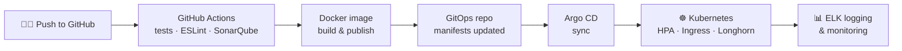

<!-- Put this file in a PUBLIC repository named exactly "mekkiamine" (same as your username), at the root, named README.md -->

 

---

## 👋 About me

Final-year Computer Engineering student at **ESPRIT**, specializing in **cloud-native architectures**, **DevSecOps practices** and **secure microservices platforms**.

I design and deploy production-grade systems on **OpenStack** and **Kubernetes** using **Docker**, with **GitOps** delivery (GitHub Actions, Argo CD). My focus is **identity management** (Keycloak, OAuth2, JWT, RBAC) and **infrastructure security**.

- 🔭 Currently working on **E-ComK8s**: a GitOps-driven Kubernetes platform for an e-commerce application
- 🎯 Interested in: Cloud Engineering · DevOps · DevSecOps · Platform Engineering
- 📬 Available from **December 1, 2026** for an end-of-studies internship (PFE), in Tunisia or abroad

---

## 🚀 Featured projects

| Project | What it is | Stack |
|---|---|---|
| **[E-ComK8s](https://github.com/mekkiamine/E-ComK8s)** | Containerized e-commerce app deployed on Kubernetes with CI/CD and GitOps (internship project at SIGA Solutions). HPA, MetalLB, NGINX Ingress, Longhorn, ELK logging, SonarQube, Sealed Secrets |      |
| **[MediConnect](https://github.com/mekkiamine/MediConnectFrontend)** | Cloud-based patient/doctor platform: RBAC with Keycloak (OAuth2/JWT), multi-factor auth (TOTP, Google SSO, facial recognition), Google Calendar sync, deployed on OpenStack |     |
| **OpenStack Private Cloud** | 7-node OpenStack Epoxy cluster built by a team of 6 (1 controller, 4 compute, 2 storage), automated with Ansible, Kubernetes on top, monitored with Prometheus + Grafana |     |
| **[Urbanova](https://github.com/mekkiamine/Urbanove-Backend)** | AI-based real estate recommendation platform: bilingual NER model (spaCy, 92–95% detection accuracy) combined with XGBoost to score and rank listings |     |

### 🔄 How E-ComK8s ships code

---

## 🛠️ Tech stack

**Cloud & DevOps**

**Infra, monitoring & quality**

**Security & identity**

**Development & data**

---

## 💼 Experience

- **DevOps / Cloud Engineer Intern**, SIGA Solutions (Jul. – Sep. 2026): Kubernetes, Argo CD, GitHub Actions, ELK, SonarQube
- **Full Stack Developer Intern**, Instar (Jul. – Sep. 2025): Angular, Node.js, AWS (EC2, S3)

## 🎓 Education

- **ESPRIT, School of Engineering**: Engineering Degree in Computer Science (expected June 2027)
- **ISET Rades**: Bachelor's Degree in Computer Science (2021 – 2024)

---

## 📊 GitHub stats

 

---

*Let's connect, I'm always happy to talk about Kubernetes, GitOps and secure cloud platforms.*

